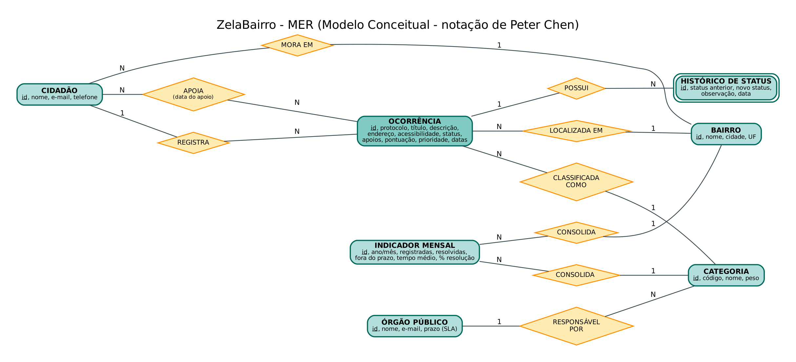
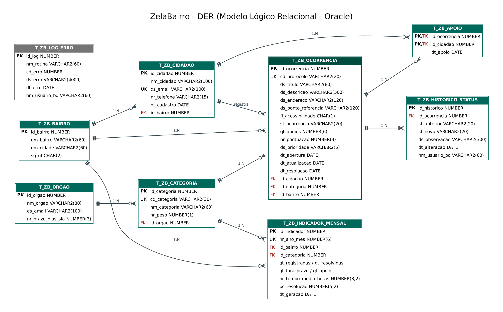

# ZelaBairro: modelo de dados

- **MER (conceitual):** `MER_ZelaBairro.png`
- **DER (lógico relacional, Oracle):** `DER_ZelaBairro.png`
- **Script físico:** `../database/01_ddl.sql`

## Entidades

| Entidade | Descrição |
|---|---|
| CIDADÃO | Usuário que registra e apoia ocorrências. |
| BAIRRO | Região onde o cidadão mora e onde a ocorrência acontece. |
| ÓRGÃO PÚBLICO | Secretaria ou departamento que atende a ocorrência, com prazo (SLA) em dias. |
| CATEGORIA | Tipo do problema. O peso (1 a 4) define a gravidade. |
| OCORRÊNCIA | Entidade central: o problema registrado, com status, prioridade e datas. |
| HISTÓRICO DE STATUS | Linha do tempo de cada ocorrência (entidade fraca, depende da ocorrência). |
| INDICADOR MENSAL | Indicadores consolidados por bairro, categoria e mês. |
| APOIO | Relacionamento N:N entre cidadão e ocorrência, com o atributo data. Vira a tabela associativa `T_ZB_APOIO`. |

## Relacionamentos e cardinalidades

| Relacionamento | Cardinalidade | Regra |
|---|---|---|
| Cidadão **mora em** Bairro | N:1 | Todo cidadão pertence a um bairro. |
| Cidadão **registra** Ocorrência | 1:N | Toda ocorrência tem um autor. Um cidadão pode registrar várias. |
| Cidadão **apoia** Ocorrência | N:N | Um cidadão apoia várias ocorrências e uma ocorrência recebe vários apoios. PK composta impede apoio duplicado. |
| Ocorrência **localizada em** Bairro | N:1 | |
| Ocorrência **classificada como** Categoria | N:1 | |
| Órgão **responsável por** Categoria | 1:N | A categoria define para qual órgão a ocorrência vai. |
| Ocorrência **possui** Histórico | 1:N (mín. 1) | Toda ocorrência nasce com um registro de histórico (trigger). |
| Indicador **consolida** Bairro e Categoria | N:1 cada | Chave única (ano_mês, bairro, categoria). |

## Dicionário de dados: T_ZB_OCORRENCIA

| Coluna | Tipo | Nulo | Regra |
|---|---|---|---|
| id_ocorrencia | NUMBER (identity) | N | PK |
| cd_protocolo | VARCHAR2(20) | N | UK, formato `ZB-AAMMDD-000001` |
| ds_titulo | VARCHAR2(80) | N | mín. 5 caracteres (procedure) |
| ds_descricao | VARCHAR2(500) | N | mín. 10 caracteres (procedure) |
| ds_endereco | VARCHAR2(120) | N | |
| ds_ponto_referencia | VARCHAR2(120) | S | |
| fl_acessibilidade | CHAR(1) | N | CHECK S/N |
| st_ocorrencia | VARCHAR2(20) | N | CHECK REGISTRADA, EM_ANALISE, EM_ATENDIMENTO, RESOLVIDA |
| qt_apoios | NUMBER(6) | N | ≥ 0, mantido pela trigger de apoio |
| nr_pontuacao | NUMBER(3) | N | calculada pela trigger |
| ds_prioridade | VARCHAR2(5) | N | CHECK ALTA, MEDIA, BAIXA (trigger) |
| dt_abertura | DATE | N | default SYSDATE |
| dt_atualizacao | DATE | N | trigger |
| dt_resolucao | DATE | S | preenchida pela trigger ao resolver |
| id_cidadao | NUMBER | N | FK → T_ZB_CIDADAO |
| id_categoria | NUMBER | N | FK → T_ZB_CATEGORIA |
| id_bairro | NUMBER | N | FK → T_ZB_BAIRRO |

As demais tabelas estão comentadas no `01_ddl.sql`.

## Modelo local do app (Room/SQLite)

O aplicativo guarda uma versão simplificada para funcionar offline:

- `ocorrencias`: reúne em uma linha os dados da ocorrência. A categoria fica como enum, já com peso e órgão. Bairro é texto e há o campo `apoiadaPorMim`.
- `historico_status`: FK `ocorrenciaId` com `ON DELETE CASCADE`.

Os códigos de categoria (`ILUMINACAO`, `BURACO_VIA`, `CALCADA_ACESSIBILIDADE`, ...) e de status são **idênticos** no app e no Oracle, o que permite a sincronização direta via API.
